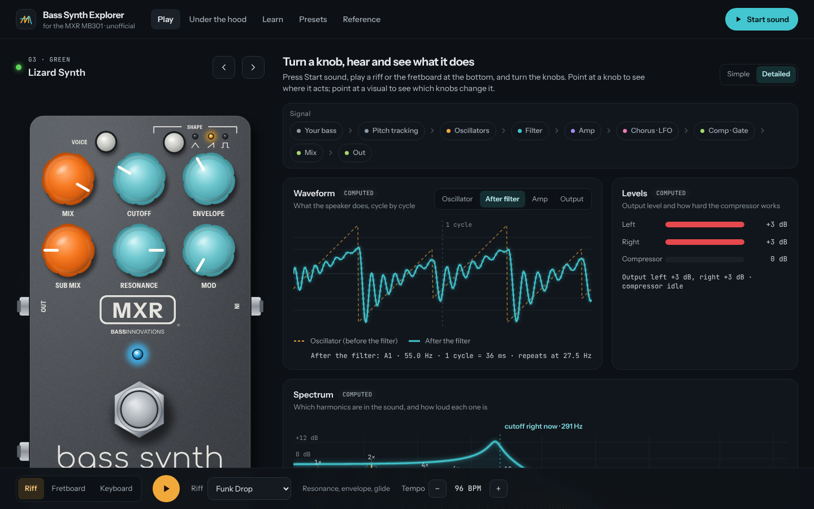
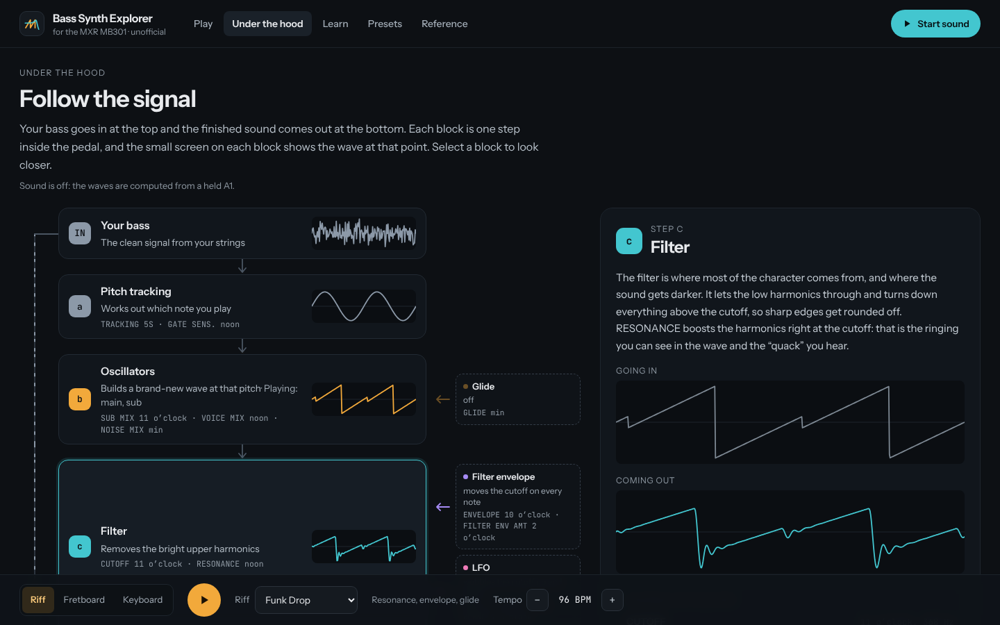
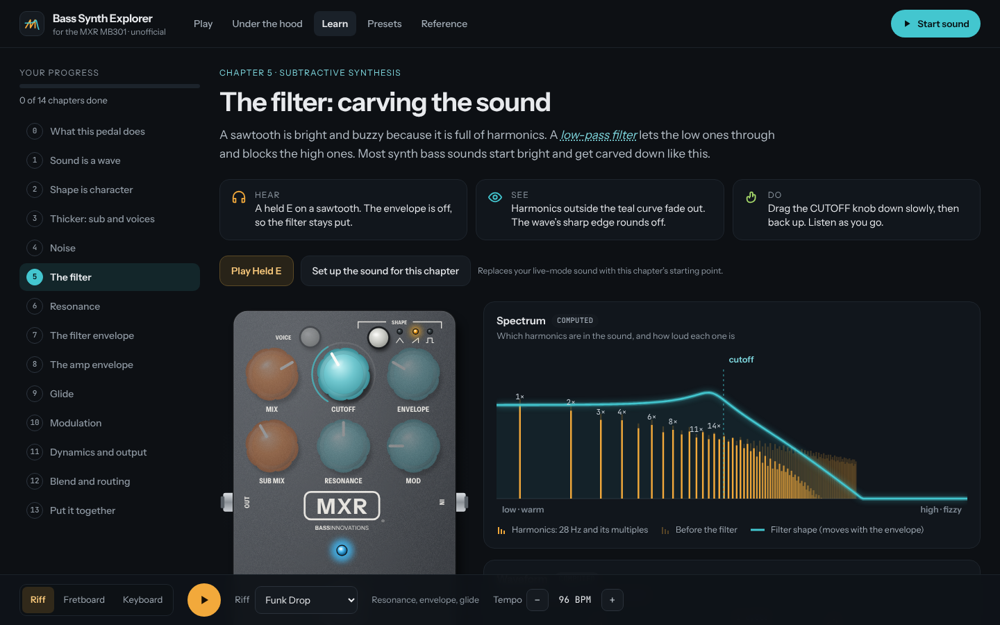
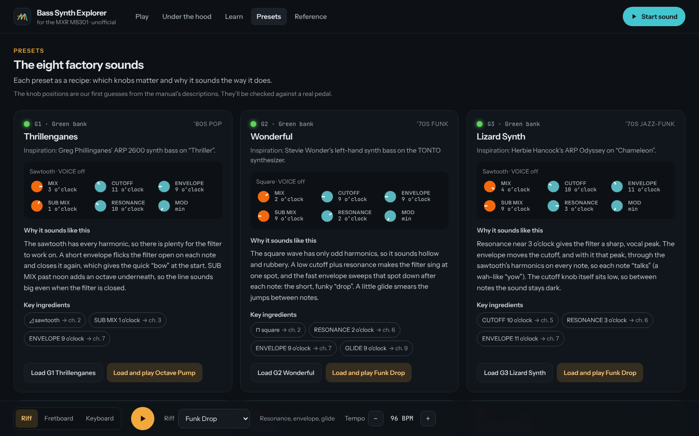
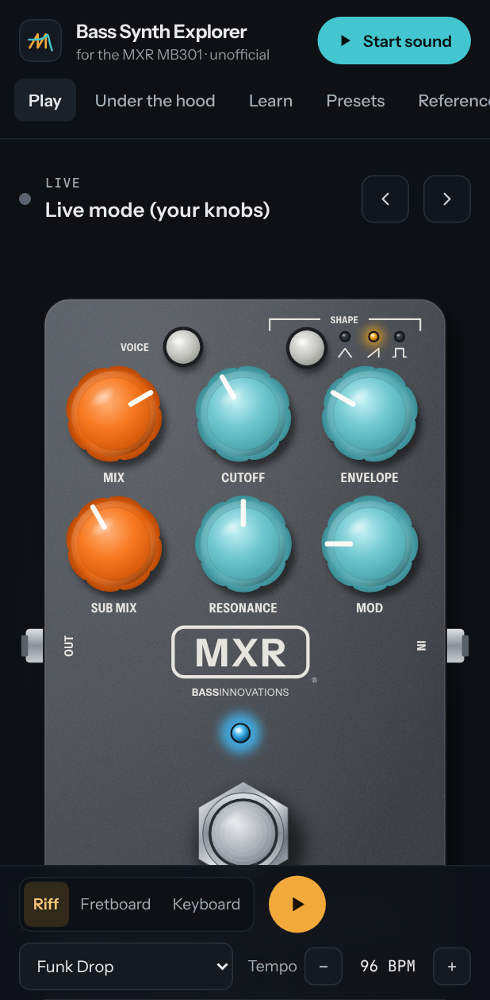

# Bass Synth Explorer

An interactive single-page web app that recreates the **MXR Bass Synth (MB301)** pedal
on screen and uses it to explain **how synthesizers make sound**, for people
who aren't synth experts. Turn a knob and hear the change, watch the waveform and
spectrum react, and follow the signal through the pedal.

> **Status:** Phases 0–9 done except the calibration against a real pedal (Phase 4b): the
> pedal is playable and audible, with live visuals, the signal flow, 14 Learn chapters, a
> presets gallery, a virtual expression pedal and a phone layout. Start with the plan, then
> look at the [mockup](https://claude.ai/artifact/VLFJfYPHoXTgFQucm1bFJD) (private artifact;
> source snapshot in [`docs/mockup/`](docs/mockup/)).



## What's inside

- **Play:** the pedal with every knob, button, secondary layer, preset and footswitch rule
  from the manual, plus waveform, spectrum, envelope, pitch, levels and (in Detailed mode) a
  spectrogram. Point at a knob to see what it changes; point at a visual to see which knobs
  change it.
- **Expression pedal:** plug in a virtual pedal, set a heel and a toe sound, and rock
  between them.
- **Under the hood:** the signal flow with the wave at every stage.
- **Learn:** 14 short chapters, each with something to hear, see and do.
- **Presets:** the eight factory sounds as recipe cards: why each one sounds the way it does.
- **Reference:** every control and a glossary. Press `?` for keyboard shortcuts.

| Under the hood                            | Learn                                          | Presets                                          | Phone                                           |
| ----------------------------------------- | ---------------------------------------------- | ------------------------------------------------ | ----------------------------------------------- |
|  |  |  |  |

## Documents

| Doc                                                    | What's in it                                                                                                         |
| ------------------------------------------------------ | -------------------------------------------------------------------------------------------------------------------- |
| [`docs/PLAN.md`](docs/PLAN.md)                         | Vision, UX, visual design, architecture, testing strategy, phased roadmap, decisions                                 |
| [`docs/pedal-reference.md`](docs/pedal-reference.md)   | The pedal's controls, secondary parameters, presets and signal flow (from the official manual) and how we model them |
| [`docs/learning-content.md`](docs/learning-content.md) | Plain-language copy: control cards, Learn chapters, glossary, built-in riffs                                         |
| [`docs/mockup/`](docs/mockup/)                         | Source snapshot of the look-and-feel mockup                                                                          |

## Stack

Svelte 5 · TypeScript · Vite · Tailwind CSS v4 · Web Audio API + AudioWorklet ·
Vitest · Playwright · GitHub Actions → GitHub Pages

## Disclaimer

This is an unofficial, non-commercial educational project. It isn't affiliated with,
endorsed by, or sponsored by Dunlop Manufacturing, Inc. MXR® and related names are
trademarks of their respective owners. The pedal drawing is original artwork, and the
sound engine is an educational model, not the pedal's actual firmware. For the real
thing, see the [official product page](https://www.jimdunlop.com/mxr-bass-synth/) and
[user guide](https://www.jimdunlop.com/content/manuals/MB301.pdf).

## Development

Requires Node 22.

```sh
npm install
npm run dev        # http://localhost:5173
npm run test:all   # lint, type check, unit + component tests, Playwright E2E
npm run build && npm run size   # initial JS against the 200 KB gzip budget
```

Screenshots, the Open Graph image and the touch icon come from
`node scripts/screenshots.mjs` while a production preview runs on port 4173.

Browser tests need Playwright's browsers (`npx playwright install chromium`), or set
`PW_CHROMIUM_PATH` to an existing Chromium.
